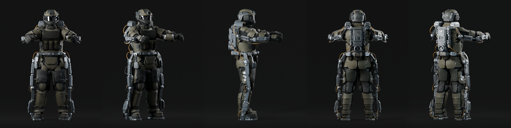

**Juggernaut From TushonkaGroup** adds a super-heavy powered assault exoskeleton to Tushonka: a walking fortress that runs on batteries.

## The set (sold by Ragman, LL4)
| Item | Price | What it is |
|---|---|---|
| **Juggernaut suit** | 15 000 000 ₽ | Full-body **class 6 Aramid** armor on a powered exoskeleton frame, 45 kg. Torso, sides, neck, shoulders, forearms, groin, thighs and calves are all covered. |
| **Juggernaut helmet** | 10 000 000 ₽ | Closed full-face **class 6 Aramid** helmet with a **built-in active headset** (Ops-Core AMP sound profile) and a **built-in thermal targeting module**. |
| **Power cell** | 8 000 ₽ (LL2, unlimited) | One cell powers the set for **5 minutes**. |

The suit and the helmet work only as a set. While the suit is worn, no other helmet, face cover, glasses or armored rig can be equipped.

## Power
In raid the suit takes power cells **from your inventory by itself**: one cell every 5 minutes. Bring a lot of them.

**Powered:**
| | |
|---|---|
| Sprint speed | ×1.8 |
| Stamina drain | ×0.35 |
| Weight limits | +60 kg |
| Jump height | ×2.0 |
| Melee damage | ×5 |
| Fall damage cushion | first 3 m of any fall |
| Vaulting while overweight | ×1.3 |
| Recoil | ×0.5 |

**Discharged** (no cells left, or no Juggernaut helmet): no sprint, no jump, ×2.5 stamina drain, −40% movement speed, −30% mouse sensitivity, −40% ergonomics. You are a very heavy, very slow target.

## Thermal targeting
The module is a head thermal device: press **N** (the game's goggles key) to toggle it. It stays on between raids, like any thermal or NVG. Enemies get a **thin bright red outline**; the picture itself is not changed, no thermal filter. Works through **scopes** and **glass**, not through walls. Range 250 m. Works only while the set is powered.

## Sound
The suit is loud: heavy footsteps that match the surface you walk on (metal, concrete, wood...), heard by others too, servo whines when you start moving, turn and jump, a heavy landing thud, dry creaks when it is discharged, and power-up / power-down cues. Volume and an on/off switch are in F12. Sources: see `sfx/CREDITS.txt`.

## Boss: the Juggernaut (Labs)
*An experimental TushonkaGroup prototype. The heavy assault exoskeleton trials ended when the test subject decided not to take the suit off. He cannot leave: the suit lives on power cells, and the cells are only here. Since then he patrols the floors of the Lab. Slow, loud, nearly indestructible. You will hear him long before you see him, and that is your only chance.*

- Spawns on **Labs** (25% per raid by default), alone.
- Fights like the Goon **Big Pipe**: a **PKP** up close, and from 27 to 130 m an **endless grenade launcher** that never reloads (weakened grenades).
- Wears the full Juggernaut set and takes only **35%** of the damage from the front. Any hit on his **battery pack** (the back or the sides of the torso, plates included) switches his armor off: for 25 s he takes full damage from every side and cannot sprint, and every new hit there restarts the timer.
- His heavy steps are heard from about 70 m.
- Loot: the Juggernaut suit and helmet, his PKP and power cells. The grenade launcher cannot be taken.
- **Test mode** (F12, "3. Juggernaut boss"): spawns him ~10 s into any raid, next to you, on every map. "Test mode: unarmed boss" spawns him without guns, so you can walk around him.

## Models
The suit, the exoskeleton frame, the helmet, the thermal module and the cell have their own 3D models and textures.

## Localization
Item names, descriptions and messages follow your game language. All 17 SPT languages are included.

## Requirements
- SPT 4.1.x (tested on 4.1.6).
- Fika (optional). The set's bonuses and drain apply to each player's own character. **Fika headless: copy `BepInEx/plugins/JuggernautClient/` into the headless client too** — the boss AI, his damage rules and his grenade launcher run on the raid host.
- SAIN (optional). If installed, the boss is registered in SAIN automatically (Bosses section); without SAIN he uses the game AI.

## Installation
Extract the archive into your SPT folder:
- `SPT_Runtime/user/mods/Juggernaut/` (server mod)
- `BepInEx/plugins/JuggernautClient/` (client plugin, thermal shader and sounds)

## Configuration
Press **F12** in game, plugin *Juggernaut From TushonkaGroup*:
| Setting | Default | Meaning |
|---|---|---|
| 1. Power: Minutes per power cell | 5 | How long one cell powers the set (server setting) |
| 2. Thermal module: Enabled | on | Allow the thermal module (server setting) |
| 2. Thermal module: Range (m) | 250 | Maximum outline distance (server setting) |
| 2. Thermal module: Outline colour | #FF1A1A | Outline colour (server setting) |
| Juggernaut sounds: Enabled, Volume | on, 1.0 | Suit sounds and their volume (this PC only) |
| 3. Juggernaut boss: Enabled, Spawn chance, Health, Damage taken, Damage on the battery pack, Grenade damage/radius, Seconds between grenades | on, 25%, x1.5, x0.35, x1.0, x0.4/x0.5, 0.6 s | The Labs boss (server settings; grenade values need a game restart) |
| 3. Juggernaut boss: Test mode, Test mode: unarmed boss | off, off | Spawn him next to you on any map, optionally without guns |

Server settings are saved in `SPT_Runtime/user/mods/Juggernaut/config.json`. In Fika, only the first player who changes them (the settings owner) can edit them.

## Credits
Made by Silian. Footsteps use the game's own surface sounds; other sound layers are synthesized or CC0 from OpenGameArt (qubodup, BMacZero).
